<div align="center">
  <picture>
    <source media="(prefers-color-scheme: dark)" srcset="./assets/terminal-dark.svg" />
    <source media="(prefers-color-scheme: light)" srcset="./assets/terminal-light.svg" />
    
  </picture>
</div>

<br />

### `❯ cat ~/about.ts`

```ts
const leonardo = {
  role: "Full-Stack Developer",
  frontend: ["TypeScript", "Next.js", "React", "Tailwind CSS", "Shadcn/UI"],
  backAndDb: ["Node.js", "PostgreSQL", "Drizzle ORM", "Prisma", "Supabase"],
  infraAndDeploy: ["Docker", "Docker Compose", "GitHub Actions", "CI/CD", "Cloudflare", "Vercel", "Linux VPS"],
  qaAndTesting: ["Playwright", "Vitest"],
  practices: ["Clean Architecture", "Type-Safe Full-Stack"],
  currentlyExploring: "UI/UX Design, Design Systems & Micro-interactions",
};
```

---

### `❯ ls -la ~/featured-projects`

| Project | Description | Stack |
| :--- | :--- | :--- |
| [**workly**](https://github.com/LeonardoBMar/workly) | Modern full-stack web application with smooth motion, containerized setup, and billing integration. | `Next.js 16` `React 19` `Tailwind v4` `Drizzle` `Docker` |
| [**nextjs-micro-saas-boilerplate**](https://github.com/LeonardoBMar/nextjs-micro-saas-boilerplate) | Production-ready Micro-SaaS starter featuring Auth.js v5, subscriptions, and type-safe database access. | `Next.js` `TypeScript` `Drizzle ORM` `Shadcn/UI` `Tailwind v4` |
| [**nextjs-clean-architecture-starter**](https://github.com/LeonardoBMar/nextjs-clean-architecture-starter) | Opinionated Clean Architecture template for scalable TypeScript web applications. | `TypeScript` `Next.js` `Clean Architecture` |

---

### `❯ cat ~/.config/toolkit`

<div align="center">
  
  
  
  
  
  
  
  
  
  
  
  
  
  
  
  
  
</div>

---

<div align="center">
  <sub><code>leonardo@github:~$ echo "Thanks for stopping by!"</code></sub>
</div>
